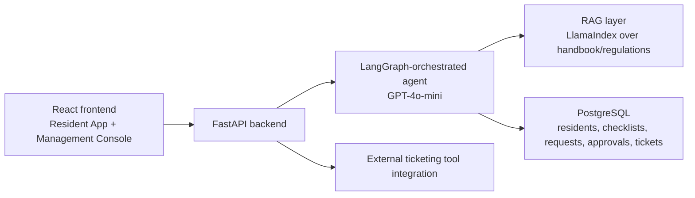
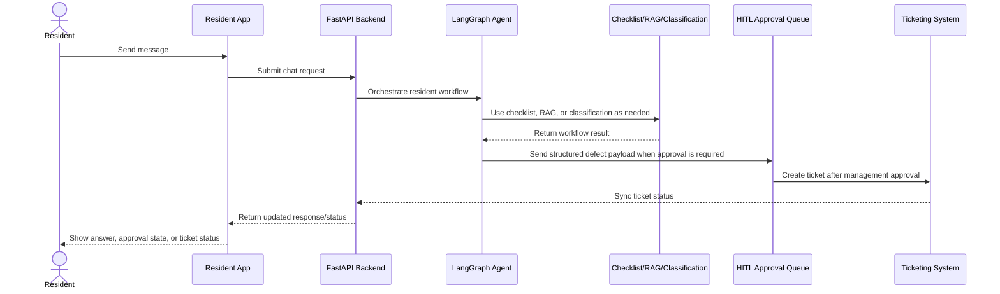

# Product Requirements Document: OnBxrD AI Agent
**Resident Onboarding & Post-Handover Care Assistant**

**Owner**: Đào Đức Mạnh
**Status**: Final
**Last Updated**: August 2, 2026

---

## 1. Executive Summary

**Product Vision**
OnBxrD AI Agent is a stateful, source-grounded AI assistant that guides new residents through personalized post-handover onboarding — from utility activation to defect reporting — while giving management full human-in-the-loop control.

- **Target user & use case**: New homeowners/residents right after unit handover, who need step-by-step onboarding guidance, answers about amenities/regulations, and a way to report and track defects; property management staff who must review and approve every commitment or ticket before it is created.
- **Key differentiator & value proposition**: Unlike scattered manual processes (phone calls, paper checklists, separate channels), OnBxrD combines a stateful onboarding checklist (LangGraph), source-grounded Q&A (RAG over the resident handbook), and structured defect-ticket escalation — all gated by mandatory human approval (HITL) so management retains authority and accountability.
- **Success definition & metrics**: Success means residents complete onboarding faster, defect requests are triaged and resolved accurately, and management spends less time on repetitive questions. Primary KPI: % of residents completing the onboarding checklist within the target window (initial target: 80% within 7 days of handover).

**Strategic Alignment**
- **Business objectives supported**: Improve post-sale customer experience; increase resident retention and referral rate; reduce management staff time spent on repetitive onboarding/Q&A tasks.
- **User problems solved**: Fragmented, unclear onboarding steps; no centralized source of truth for building rules; opaque defect-reporting process with no status visibility.
- **Market opportunity & timing**: Developers/operators handing over large volumes of units at once face a scaling bottleneck in customer care; an AI-driven onboarding layer lets them scale support without proportional headcount growth, at a moment when resident experience directly drives referral-based sales.
- **Competitive advantage gained**: A single, personalized, always-available onboarding and support agent — differentiated from competitors' manual, multi-channel processes — while keeping human oversight for every commitment.

**Resource Requirements**
- **Development effort estimate**: MVP buildable by a small cross-functional team in 6–8 weeks (pilot/hackathon-scale project).
- **Timeline & key milestones**: Discovery & data prep (week 1) → Core agent + checklist flow (weeks 2–4) → Ticketing + HITL approval (weeks 4–5) → Testing, eval, and pilot launch (weeks 5-6).
- **Team members & skills needed**: 1 backend engineer (FastAPI/Postgres), 1 frontend engineer (React), 1 AI/ML engineer (LLM orchestration, RAG, LangGraph), part-time product/design support.
- **Budget & resource allocation**: Limited/pilot-stage budget; primary costs are LLM API usage (GPT-4o-mini), Render hosting, and engineering time — no dedicated infrastructure team assumed.

---

## 2. Problem Statement & Opportunity

**Problem Definition**
After a resident receives their unit, onboarding today spans multiple disconnected touchpoints: handover paperwork, utility activation, building-rule explanations, and defect reporting — each handled manually and inconsistently by management staff. Residents lack a single guided flow, must actively seek out information, and have no visibility into the status of defect requests once submitted. This creates a weak post-sale experience precisely at the moment that most shapes a resident's willingness to recommend the property to others. The problem statement is based on the developer/operator's direct observation of current onboarding operations (fragmented process, poor post-sale experience, reduced referrals) as the origin and motivation for this project.

**Opportunity Analysis**
- **Market size & growth potential**: Any developer/operator handing over units at scale (dozens to thousands of units per project) faces this same onboarding bottleneck; the solution generalizes across residential projects.
- **User segment size & characteristics**: All residents in a newly handed-over building/phase — typically a concentrated wave of onboarding demand in the weeks immediately following handover.
- **Revenue opportunity & business impact**: Improved referral rates reduce customer acquisition cost for future phases/projects; reduced management workload lowers ongoing operating cost per unit.
- **Competitive gap this addresses**: Most operators still rely on manual, multi-channel coordination with no structured, auditable escalation path — OnBxrd closes this gap with a single AI-driven, human-supervised workflow.

**Success Criteria**
- **Primary success metrics & targets**: % onboarding checklist completion (target 80% within 7 days); average onboarding completion time; % Q&A answers correctly source-grounded.
- **Secondary metrics to monitor**: Defect ticket resolution time and routing accuracy; HITL approval turnaround time; resident satisfaction score.
- **User behavior changes expected**: Residents self-serve onboarding steps and routine questions through the agent instead of calling management directly.
- **Business outcomes anticipated**: Higher referral rate, lower management support load, faster and more consistent defect resolution.

---

## 3. User Requirements & Stories

**Primary User Personas**

*Persona 1 — New Resident*
- Goals: Complete onboarding quickly and correctly; understand amenities/regulations; report and track defects.
- Current workflow & pain points: Ad hoc calls/messages to management office; no centralized checklist; unclear defect status.
- Success criteria: Onboarding completed with minimal back-and-forth; questions answered instantly and accurately; defects resolved and visible end-to-end.

*Persona 2 — Property Management Staff*
- Goals: Review and approve requests before commitments are made; monitor resident onboarding progress at scale; avoid unauthorized commitments.
- Current workflow & pain points: Manually fielding repetitive questions and requests; no structured queue or audit trail; risk of overload during handover waves.
- Success criteria: Clear approval queue (HITL); visibility into resident progress and request status; confidence that the agent never commits outside its authority.

**User Journey Mapping**
- **Current state**: Resident receives keys → contacts management ad hoc for each need (utilities, rules, defects) → inconsistent, undocumented responses → resident uncertain of status or next steps.
- **Future state**: Resident opens OnBxrD app → agent presents personalized onboarding checklist → resident asks questions answered with cited sources → resident reports a defect → agent classifies it and routes to management for approval (HITL) → ticket created and status tracked to completion → resident notified at each milestone.
- **Key touchpoints**: Checklist walkthrough, Q&A interaction, defect intake, HITL approval, status updates.
- **Pain points/opportunity areas addressed**: Centralizing information (RAG), replacing manual triage with classification, and replacing informal commitments with an auditable HITL gate.

**Core User Stories** (Epic-level, prioritized)

1. *Onboarding checklist guidance* (Must Have)
   - As a new resident, I want the agent to walk me through a personalized onboarding checklist so that I know exactly what steps remain and complete them without confusion.
   - Given a resident has just been added to the system, when they open the app, then the agent presents their current checklist step and next action.
   - Acceptance criteria: Checklist state persists across sessions; resident can see completed vs. pending steps; agent references the correct step context in conversation.

2. *Source-grounded Q&A* (Must Have)
   - As a resident, I want to ask questions about amenities and building regulations so that I get accurate answers without calling management.
   - Given the resident asks a question covered in the handbook/regulations, when the agent responds, then it cites the source section.
   - Acceptance criteria: Answers are grounded in the RAG knowledge base; unanswerable questions are flagged rather than guessed; source reference is shown to the resident.

3. *Defect/repair request intake and classification* (Must Have)
   - As a resident, I want to report a defect through the agent so that it gets routed to the right team without me needing to know who to contact.
   - Given a resident describes a defect, when the agent processes it, then it classifies the request type and prepares a structured request for approval.
   - Acceptance criteria: Request is captured with resident, unit, description, and category; classification is visible to the approver.

4. *HITL approval before ticket creation* (Must Have)
   - As a management staff member, I want to review and approve every request before a ticket is created or a deadline is committed, so that the agent never acts outside its authority.
   - Given a classified request, when it reaches the approval queue, then no ticket is created or communicated to the resident until a staff member approves it.
   - Acceptance criteria: Approval queue shows pending requests; approve/reject/edit actions are logged; resident is only notified after approval.

5. *Status tracking to completion* (Must Have)
   - As a resident, I want to see the status of my defect request so that I know what is happening and when it will be resolved.
   - Given an approved ticket, when its status changes, then the resident sees the updated status in the app.
   - Acceptance criteria: Status states (submitted, approved, in progress, resolved) are visible; updates reflect ticketing system state or documented fallback when unavailable.

6. *Priority classification and routing* (Should Have)
   - As management, I want requests automatically prioritized so that urgent issues (e.g., safety, utilities) are surfaced first.
   - Acceptance criteria: Requests are tagged with a priority level; approval queue can be sorted by priority.

7. *Milestone reminders* (Should Have)
   - As a resident, I want reminders about upcoming onboarding milestones so that I don't miss required steps.
   - Acceptance criteria: Agent proactively surfaces upcoming/overdue checklist items.

8. *Per-resident memory* (Should Have)
   - As a resident, I want the agent to remember my prior interactions so that I don't have to repeat information.
   - Acceptance criteria: Agent retrieves and uses prior conversation/context relevant to the current session.

9. *Satisfaction survey & insight aggregation* (Could Have)
   - As management, I want aggregated satisfaction data so that I can identify systemic onboarding issues.
   - Acceptance criteria: Survey triggered after checklist completion; results aggregated into a management-facing summary.

10. *Routing/resolution evaluation* (Could Have)
    - As a product owner, I want to evaluate whether requests are resolved through the correct workflow so that I can measure and improve routing accuracy.
    - Acceptance criteria: Evaluation reports the rate of correctly routed/resolved requests against defined rubrics.

---

## 4. Functional Requirements

**Core Features (Must Have)**
- **Resident App**: Login, personalized onboarding checklist view, chat interface for Q&A and defect reporting, request status view.
- **Management Console**: Approval queue (HITL) for tickets/commitments, resident onboarding progress overview, request history.
- **Onboarding Agent (LangGraph)**: Maintains per-resident checklist state across sessions; guides resident step by step; updates state as steps complete.
- **Source-grounded Q&A (RAG + LlamaIndex)**: Answers questions using the resident handbook and building regulations; cites source; declines to answer ungrounded questions.
- **Defect/Repair Intake & Classification**: Captures resident-reported issues, classifies by type, prepares structured request.
- **HITL Approval Workflow**: All ticket creation and deadline commitments require explicit management approval before any ticket is created or communicated to the resident.
- **Ticket Creation Tool Integration**: Creates tickets in the ticketing system upon approval; handles unresponsive-system errors gracefully (retry/fallback, visible error state).
- **Chat Summary agent**: A persistent in-chat summary that aggregates the resident's onboarding progress, open requests, and key answers - similar to Meta AI's chat summary feature.

**Secondary Features (Nice to Have)**
- Priority-based classification and routing of requests.
- Automated reminders for upcoming/overdue onboarding milestones.
- Per-resident memory of prior interactions and preferences.
- Post-onboarding satisfaction survey with aggregated insight reporting for management.
- Evaluation framework measuring correct-routing/resolution rate.

**Feature Prioritization (MoSCoW)**
- **Must**: Checklist guidance, source-grounded Q&A, defect intake/classification, HITL approval, status tracking, error handling for ticketing downtime, overload alerting.
- **Should**: Priority routing, milestone reminders, per-resident memory.
- **Could**: Satisfaction survey/insight aggregation, routing/resolution evaluation.
- **Won't (this phase)**: Automated ticket creation without HITL approval; commitments made by the agent outside its authorized scope.

---

## 5. Technical Requirements

**Architecture Specifications**
- **System overview**:

- **Component definitions**: Onboarding checklist manager (LangGraph state machine); Q&A/retrieval service (LlamaIndex index + LLM); classification/routing module; HITL approval service; ticket-creation connector.
- **Data flow**:

- **Scalability/performance**: Must handle concentrated onboarding waves right after handover (many residents onboarding within the same short window).

**API Requirements**
- Endpoints for: resident authentication, checklist state retrieval/update, chat/Q&A interaction, defect request submission, approval queue (list/approve/reject/edit), ticket status retrieval.
- Request/response formats: JSON; each defect request includes resident ID, unit ID, description, classification, priority (if enabled), and status.
- Authentication/authorization: Role-based (resident vs. management); resident can only access their own data; management can access requests/status across residents.
- Rate limiting/error handling: Graceful degradation and clear error messaging when the ticketing system is unresponsive; retry logic with backoff.

**Data Requirements**
- **Data model**: Residents, Units, Checklists/ChecklistSteps, Conversations, DefectRequests, Approvals, Tickets, KnowledgeBase documents (handbook/regulations).
- **Data sources/integrations**: Resident handbook and regulation documents (indexed via LlamaIndex); ticketing system integration.
- **Validation/constraints**: Defect requests must reference a valid resident/unit; approvals must be tied to an identified management user.
- **Privacy/security**: Resident personal data access restricted by role; no data exposed to unauthorized parties.

**Performance Specifications**
- Near real-time conversational response for checklist guidance and Q&A.
- Persistent, reliable state tracking per resident across sessions.
- Overload alerting when request volume exceeds expected thresholds during handover waves.

---

## 6. User Experience Requirements

**Design Principles**
- Conversational, guided experience that reduces resident effort rather than adding another form to fill out.
- Transparency: always show checklist progress and request status; always cite sources for factual answers.
- Trust through visible human oversight: resident understands that certain actions require management approval.

**Interface Requirements**
- **Resident App**: Chat-first interface with a visible checklist/progress panel; defect-reporting flow embedded in chat; status view for submitted requests.
- **Management Console**: Approval queue (dashboard), resident progress overview, request/ticket history.
- **Responsive design**: Resident App optimized for mobile; Management Console optimized for desktop.

**Usability Criteria**
- High task completion rate for onboarding checklist steps.
- Clear, actionable messaging when the agent cannot answer or a request is pending approval.
- Minimal learning curve — resident should be able to start onboarding immediately after first login.

---

## 7. Non-Functional Requirements

**Security Requirements**
- Role-based access control distinguishing resident and management users.
- Confidentiality and protection of resident personal information.
- The agent must never make commitments (deadlines, guarantees) outside its authorized scope.
- Mandatory HITL approval before any ticket creation or deadline commitment.
- Audit trail of all HITL approvals and agent actions.

**Performance Requirements**
- Conversational response times suitable for real-time chat interaction.
- Reliable handling of concurrent onboarding sessions during handover waves.

**Reliability Requirements**
- Graceful fallback/retry when the ticketing system does not respond.
- Overload alerting so management is notified when request volume exceeds capacity.

**Scalability Requirements**
- Designed to handle the concentrated demand of a full building/phase handover, not just isolated individual onboarding.

---

## 8. Success Metrics & Analytics

**Key Performance Indicators**
- Onboarding checklist completion rate and time-to-completion.
- % of Q&A answers correctly grounded with a cited source.
- Defect request classification accuracy and resolution time.
- HITL approval turnaround time.
- Resident satisfaction score.
- Referral rate uplift versus pre-launch baseline.

**Analytics Implementation**
- Track checklist step completions, Q&A interactions (with/without grounded source), defect request submissions and outcomes, approval actions and turnaround time.
- Management-facing dashboard summarizing onboarding progress and request status across residents.

**Success Measurement**
- Baseline: current (manual) onboarding completion time and referral rate, where available.
- Targets: e.g., 80% checklist completion within 7 days; reviewed after pilot launch and adjusted based on observed data.

---

## 9. Implementation Plan

**Development Phases**
- **Phase 1 — Discovery & Data Prep**: Gather resident handbook/regulation content for RAG indexing; define checklist structure and defect categories.
- **Phase 2 — Core Agent & Checklist Flow**: Build LangGraph-based onboarding checklist manager; build resident chat interface; integrate RAG Q&A.
- **Phase 3 — Ticketing & HITL Approval**: Build defect classification, approval queue, ticket-creation integration, and error handling for ticketing downtime.
- **Phase 4 — Testing, Eval & Pilot Launch**: Test end-to-end flows; pilot with a subset of residents/units; gather feedback and iterate.

**Resource Allocation**
- Backend engineer(s) for FastAPI/Postgres and ticketing integration.
- Frontend engineer for React Resident App and Management Console.
- AI/ML engineer for LangGraph orchestration, RAG indexing, and classification logic.
- Product/design support for checklist UX and approval queue design.

**Timeline and Milestones**
- Weeks 1–2: Discovery, data prep, checklist/defect taxonomy defined.
- Weeks 3–4: Core onboarding agent and Q&A functional.
- Weeks 5–6: Defect intake, HITL approval, ticket integration functional.
- Weeks 7–8: End-to-end testing, pilot launch, feedback collection.

---

## 10. Risk Assessment & Mitigation

**Technical Risks**
- Ticketing system unresponsiveness or downtime → mitigate with retry/fallback logic and visible error states.
- RAG answers not properly grounded → mitigate by requiring source citation and declining to answer when confidence/grounding is insufficient.
- Overload during concentrated handover waves → mitigate with overload alerting and queue management for HITL approvals.

**Business Risks**
- Resident distrust if the agent appears to make unauthorized commitments → mitigate with strict HITL gating and transparent status messaging.
- Low resident adoption of the app → mitigate with a simple, guided first-use experience and proactive checklist prompts.
- Management staff bypassing the HITL queue under time pressure → mitigate by making the approval workflow faster than the manual alternative it replaces.

**Mitigation Strategies**
- Continuous monitoring of grounded-answer rate, approval turnaround time, and ticketing error rate.
- Pilot with a limited resident/unit group before full rollout to validate assumptions and refine classification/routing logic.
- Clear escalation path for cases the agent cannot handle (handoff to human staff).

---

## 11. Demo UI Surface (Production-Style Mock)

The static demo in `docs/demo` exposes four tabbed surfaces that make the Phase 1 workflow observable without a backend:

- **Landing**: Boomerang positioning and direct links into the working surfaces. Booking, purchasing, and unrelated conversion actions are intentionally excluded from the demo.
- **Onboarding**: A resident checklist with step-by-step agent guidance, grounded answers with source references, and a resident context summary.
- **In-app chat**: A resident conversation inside the OnBxrD app for handbook Q&A and maintenance issue intake. The agent detects ticket intent, collects the structured fields, and asks for confirmation before creating a ticket.
- **Ticket**: A resident ticket workspace with a dedicated one-to-one conversation. The resident reviews the structured request before submission, then sees status events and follow-up messages in the same ticket thread.

The demo uses React state and mock data only. It represents the same authorization boundary required in production: agent classification may prepare a request, but ticket creation remains gated by human approval.

