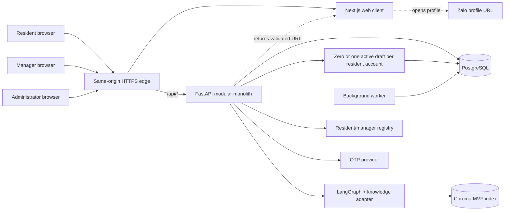

# OnBxrd MVP Architecture Diagram

This compatibility diagram points to the authoritative architecture views. The detailed container view is in [`container-architecture.md`](container-architecture.md); trust boundaries are in [`system-context.md`](system-context.md).

The browser is untrusted. Web assets and `/api/*` share one public origin, while FastAPI remains the application boundary. PostgreSQL is the source of truth. The registry is a read/version dependency; OnBxrd owns local account claims. Zalo is an outbound URL handoff only.
