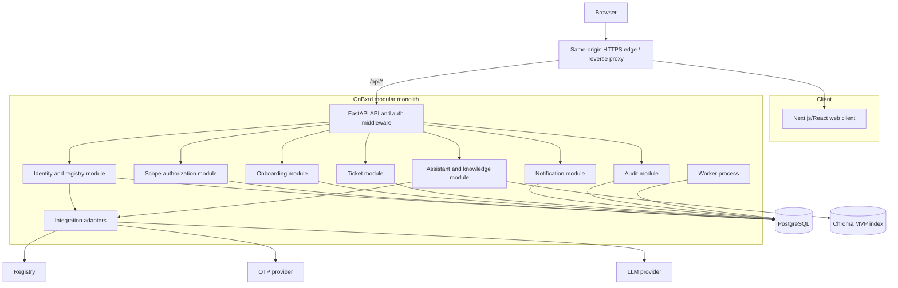

# Container Architecture

## Runtime Containers

## Responsibilities

### Web client

Owns role-specific presentation, route transitions, accessibility behavior, client validation, unsaved edit buffers, and visible draft conflict recovery. It never decides authorization or writes verified resident/location fields.

The browser calls FastAPI through same-origin `/api/*`. Next.js route handlers do not become a second domain API or authorization layer.

### FastAPI API

Owns authentication middleware, request validation, application-service orchestration, scope checks, transaction boundaries, and stable JSON error semantics. It is the only public application backend.

### Identity and registry module

Owns account lifecycle, verified contacts, password hashing, sessions, registration challenges, local registry claim/reservations, registry projections, and administrator pending-activation boundaries.

### Scope module

Owns exact building-floor grants, `ALL_FLOORS` grants, authorization predicates, and scope-aware resource queries.

### Onboarding module

Owns step definitions, resident progress, completion, and due reminder jobs. It does not own document uploads in MVP.

### Ticket module

Owns the account-unique persistent ticket draft, generation/version concurrency, durable submission idempotency, atomic submission/delete, immutable submitted snapshots, status events, and ticket-specific notification events.

### Notification module

Owns durable campaigns, preview/audience resolution, in-app recipient records, read/unread mutations, the `Notify` flow, and notification outbox jobs. The type field is extensible; the MVP guarantees conflict notifications and ticket-related notifications without freezing the broader catalog.

### Assistant module

Owns Vietnamese chat orchestration, grounded retrieval, source references, and constrained ticket-field patches. It cannot call ticket submission or mutate verified profile fields.

### Worker

Owns scheduled onboarding reminders, invitation/OTP expiration cleanup, notification fan-out, and retryable outbox jobs. It processes at least once using PostgreSQL leases, bounded retries, dead-letter state, and consumer idempotency keys.

## Dependency Rules

- API routes call application services, never repositories directly.
- Domain modules may depend on shared primitives and contracts, not each other's tables.
- Integrations are reached only through adapters.
- Notification creation is an event of the owning domain; notification delivery is not a ticket-state mutation.
- The frontend may cache server state but cannot become a second source of truth.

## Brownfield Migration Boundary

The current `src/services/mvp.py` is a demo service with server-persisted drafts, hard-coded resident data, SQLite tables, and superseded statuses. It is not extended in place as the production domain model. The implementation should introduce the module boundaries above and migrate behavior behind the API contract.
