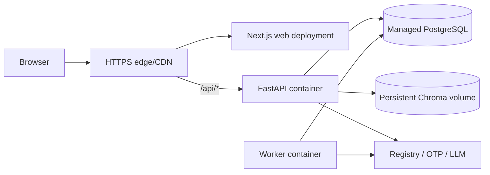

# Deployment Architecture

## Environments

| Environment | Purpose | Data rules |
|---|---|---|
| Local | Developer feedback and integration | Synthetic registry/OTP adapters; local PostgreSQL/Chroma |
| Test/CI | Automated deterministic checks | Ephemeral PostgreSQL; mocked external providers; no real PII |
| Staging | End-to-end acceptance and migration rehearsal | Non-production registry/provider credentials; sanitized data |
| Production | Approved MVP operation | Managed secrets, TLS, backups, monitored dependencies |

## Build and Runtime Topology

The API and worker use the same versioned backend image with different commands. The current multi-stage Python 3.11 Dockerfile and GitHub Actions workflow are retained as the backend baseline. The public edge provides one origin; production does not expose a credentialed cross-origin API.

MVP Chroma is a versioned persistent index mounted read-only by one assistant-serving API replica. Index build/ingestion runs as an explicit deployment job against a new version, validates it, then switches during an announced maintenance window. No two runtime writers share the index. Assistant maintenance/degradation does not make ticket, profile, onboarding, or notification APIs unavailable. Horizontal assistant scale is deferred until performance targets exist; PostgreSQL remains independently scalable and is never replaced by Chroma.

## Compatibility Baseline

The architecture review verified the current ecosystem on 2026-08-11. Implementation starts from this compatibility envelope and commits exact patch versions and lockfiles before the first build:

| Layer | MVP baseline |
|---|---|
| Backend runtime | Python 3.11, FastAPI 0.141.x |
| Relational stack | SQLAlchemy 2.0.x, Alembic 1.19.x, Psycopg 3.x |
| Frontend runtime | Node.js 22 LTS |
| Frontend framework | Next.js 16.3.x, React 19.2.x, TypeScript |
| Database | PostgreSQL 17 managed or containerized consistently across CI/staging/production |
| Knowledge prototype | Existing LangGraph/LlamaIndex/Chroma family, exact compatible versions locked during migration |

Major-version changes require an ADR or compatibility review. Local, CI, staging, and production use the same runtime/database majors.

## Local Composition

Development compose should include:

- `frontend`;
- `backend`;
- `worker`;
- `postgres`;
- persistent Chroma data; and
- optional local/mock registry and OTP adapters.

Local development also uses one browser origin through the frontend/dev reverse proxy so cookie and CSRF behavior matches production.

The existing `docker-compose.yml` runs only the prototype backend and must be expanded during implementation; this architecture document does not modify production code or deployment files.

## Configuration and Secrets

- Non-secret configuration is injected by environment variables with startup validation.
- Secrets use the deployment platform's secret manager/environment injection.
- No secret is prefixed for frontend exposure unless it is intentionally public.
- Separate credentials per environment for database, registry, OTP, LLM, and telemetry.
- Rotate provider credentials without rebuilding images.
- Startup fails closed when required production secrets are absent.

`.env.example` now contains only a fake placeholder for `AI_LOG_API_KEY`. Because the previous value was credential-shaped and may have been usable, rotate/revoke it and audit repository history/telemetry before any external deployment.

## Database Migrations

- Use Alembic migrations checked into source control.
- Draft migrations enforce unique `resident_account_id`, immutable/unpredictable `draft_id`, positive versions, and durable unique `(resident_account_id, idempotency_key)` submission results.
- Apply migrations as a release step before routing traffic.
- Migrations must be backward-compatible with the previous application version for one rollback window.
- Destructive data changes require a separate expand/migrate/contract sequence.
- No runtime `CREATE TABLE IF NOT EXISTS` in application startup.

## Observability

Minimum signals:

- structured logs with request/job correlation IDs;
- HTTP request count/error/latency distributions without binding product targets;
- registration/OTP/provider failure counts;
- ticket transition conflicts and invalid transition attempts;
- ticket draft start/update/version-conflict/generation-gone/submit failure counts without draft content;
- notification job attempts/failures;
- worker backlog age and lease failures;
- dead-letter job count and oldest age;
- manager registry projection refresh failures/scope changes;
- database connectivity/pool health; and
- LLM/knowledge dependency availability and safe-degradation counts.

Logs and traces must redact resident IDs, contact values, ticket content, raw chat, Zalo URLs, cookies, OTPs, and provider tokens.

## Health Checks

- `/health/live`: process event loop is responsive; no external calls.
- `/health/ready`: required database migration level and PostgreSQL connectivity are valid; required configuration loaded.
- Worker readiness: database lease access and required job configuration available.
- External registry/OTP/LLM degradation is reported as dependency health but does not make unrelated authenticated features unready.

## Backup and Recovery Assumptions

- Managed PostgreSQL point-in-time recovery and encrypted backups are required for production.
- Restore rehearsal occurs in staging before launch.
- Chroma index is reproducible from approved source content and configuration; it is backed up for convenience but not treated as irreplaceable product state.
- Session, OTP, and job data may be invalidated after a disaster recovery event; accounts, active ticket drafts, submitted tickets, and history must remain consistent.

## Rollback

- Deploy immutable image tags/digests.
- Keep the previous web/API/worker versions available for rollback.
- Roll back application containers only while the database schema remains backward-compatible.
- Disable or drain worker processing during incompatible rollback/migration windows.
- Chroma index rollback switches to the last validated read-only version; assistant requests may be unavailable during the switch.
- Feature exposure may be controlled by server-side configuration, but flags cannot bypass authorization or support two ticket state machines indefinitely.

## Deployment Decisions Deferred

Cloud vendor, exact service sizing, autoscaling targets, quantitative SLOs, and performance budgets are deferred. The topology above remains provider-neutral and compatible with the repository's existing container/CI conventions.
