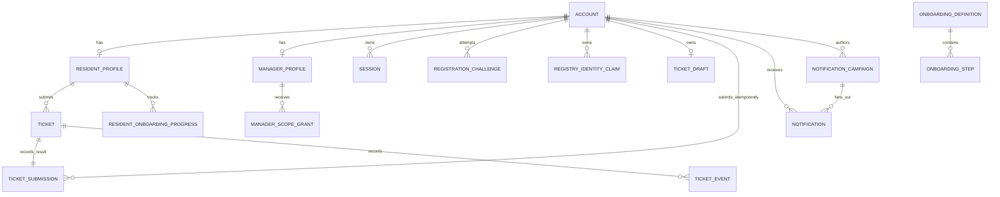
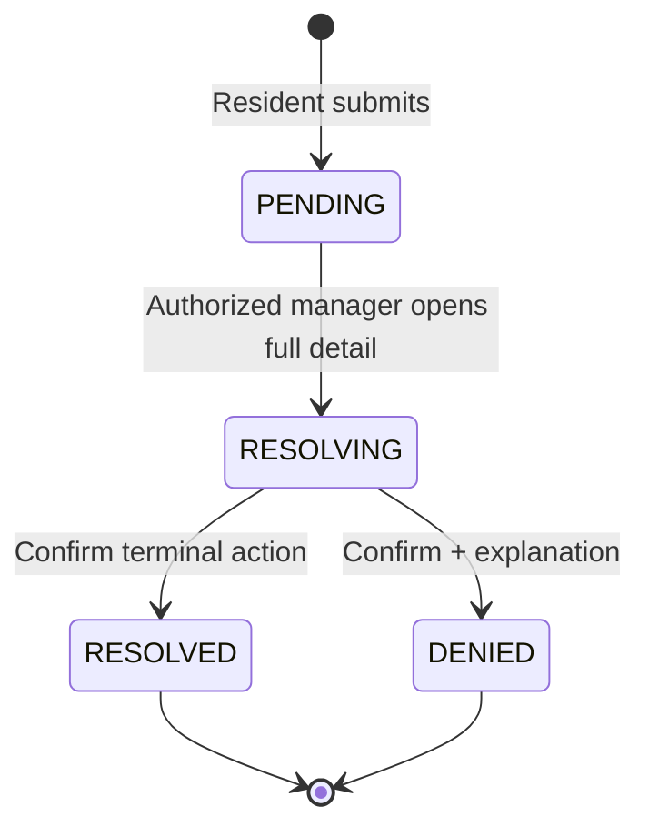

# Domain Model

## Domain Ownership

| Domain | Owns | Does not own |
|---|---|---|
| Identity | Accounts, verified contacts, credentials, sessions, OTP challenges, local registry claims, activation invitations | Building/floor business definitions, ticket status |
| Resident | Resident profile projection and current location association | Registry source data, historical ticket snapshots |
| Manager Scope | Manager profile projection and building-floor grants | Ticket state, registry maintenance |
| Onboarding | Step definitions, resident progress, reminder due state | Document uploads, benefit governance |
| Benefits | Resident-readable benefit records and eligibility projection | Governance workflow and ownership policy |
| Tickets | One active account draft, submitted ticket, immutable snapshots, lifecycle, versions, events | Manager account scope definitions |
| Notifications | Campaign intent, scoped audience preview, recipient records, read state | Ticket state mutation, external channel delivery |
| Assistant | Grounded answer and ticket-field patch proposal | Ticket submission, verified profile mutation, source governance |
| Audit | Cross-domain security and administrative audit entries | Domain state itself |

## Primary Entities

### Account

- `id`
- `role`: `resident`, `manager`, or `administrator`
- immutable `username`
- `password_hash`
- `status`: `active`, `deactivated`, or `pending_activation`
- immutable registry identity reference for resident/manager accounts
- current verified account phone and email
- created/updated timestamps

Administrator accounts have no public registration path. Resident and manager IDs cannot be changed after claim.

### ResidentProfile

- `account_id`
- `registry_resident_id`
- current display name and preferences
- current `building_id`, `floor_id`, and `unit_id`
- normalized rule-validated Zalo URL, validation timestamp/status, and `validator_version`

Building/floor/unit changes are administrator-controlled or registry-projected and do not rewrite ticket snapshots. Ticket phone snapshots use the account's current verified phone, not a duplicate profile field.

### ManagerProfile and ManagerScopeGrant

- `account_id`
- `registry_manager_id`
- display fields and preferences
- one or more grants:
  - exact `(building_id, floor_id)`; or
  - `(building_id, ALL_FLOORS)`

Grants are derived automatically from the manager registry ID. Managers cannot edit them.

### RegistryIdentityClaim and AccountActivationInvitation

- one unique local claim per `(role, registry_identity_id)`;
- source registry version and last successful projection check;
- claim state: `reserved` or `active`;
- optional administrator-created invitation with expiry/status; and
- idempotency and audit references.

OnBxrd owns claim state for MVP. An administrator-created invitation reserves the identity but does not create an active credentialed account. The resident or manager completes registry-contact OTP verification and chooses username/password before the claim becomes active. Expired/cancelled reservations are released through an audited job or administrator action.

### RegistrationChallenge

- registry identity reference and requested role
- normalized matching contact destination
- hashed one-time code
- expiry, attempt count, send count, status
- idempotency key and created/verified timestamps

The local identity claim and account creation occur only after successful verification. The registry is read-only and is not part of the PostgreSQL commit.

### OnboardingDefinition, OnboardingStep, ResidentOnboardingProgress

- Definitions are building-scoped, immutable after publication, and identified by version.
- Steps have stable keys across versions; display order is version-specific.
- Each resident enrollment is pinned to one definition version and progress is persisted against stable step keys.
- Existing residents do not inherit a new version automatically. An explicit audited migration carries completion for matching step keys, preserves retired-step history, and leaves newly required steps incomplete.
- MVP does not include document upload.
- Automated reminders are derived from incomplete required steps and scheduled jobs.

### Benefit

- Building-scoped resident-readable content and eligibility projection.
- Governance, content ownership, approval, and retention are deferred.
- Benefit presentation is not a ticket or authorization source.

### TicketDraft

- immutable unpredictable `draft_id` identifying one draft generation
- unique `resident_account_id`
- editable `subject`, `content`, and `urgency`
- integer `version` for optimistic concurrency
- created/updated timestamps

Only an authenticated resident can access their own draft. Manual and assistant flows use the same row. Starting when a row exists resumes it. Explicit replacement atomically installs a new `draft_id` generation in the same account-owned slot; it does not create a second active row. Mutations compare account, `draft_id`, and version, preventing an old request from matching a later generation. There is no draft history entity in MVP. Successful submission creates the ticket and deletes the draft atomically.

An account may have no active draft. Active drafts do not expire for inactivity in MVP. Logout/session expiry do not delete them; deactivation makes them inaccessible until account restoration.

### TicketSubmission

- resident account ID
- submission idempotency key, unique per resident account for the ticket-history lifetime
- source `draft_id`, source version, and accepted payload fingerprint
- created ticket ID and committed timestamp

`TicketSubmission` is a durable outcome mapping, not a second ticket lifecycle. It is committed in the same transaction as ticket creation and draft deletion. A retry with the same account/key and fingerprint returns the original ticket; a different fingerprint is rejected.

### Ticket

Persistent fields:

- `id`
- `resident_account_id`
- `subject`
- `content`
- `urgency`: `LOW`, `NORMAL`, or `HIGH`
- immutable resident snapshot: name and phone
- immutable location snapshot: building number/ID, floor number/ID, room/unit
- `status`: `PENDING`, `RESOLVING`, `RESOLVED`, or `DENIED`
- `version` integer for optimistic concurrency
- optional `denial_explanation`, required only when terminal state is `DENIED`
- submitted, updated, resolved/denied timestamps

There is no responsible-manager field. Manager actions are attributed through events.

### TicketEvent

- ticket ID and monotonically ordered event sequence
- actor account ID and actor role
- event type and from/to state where applicable
- accepted ticket version
- optional denial explanation or conflict metadata
- timestamp

Events are append-only and support resident-visible status history and operational audit.

### NotificationPreview, NotificationCampaign, and Notification

`NotificationPreview` is short-lived and records the proposed send:

- author manager account ID;
- subject/content fingerprint and normalized audience selector;
- manager scope version;
- resolved recipient-set hash/count; and
- expiry.

`NotificationCampaign` records the accepted manager send intent:

- author manager account ID;
- subject and content;
- normalized audience selector;
- accepted exact recipient snapshot and preview reference;
- status: `accepted`, `fanout_complete`, or `failed`; and
- submission idempotency key and audit references.

Whole-building selectors require an `ALL_FLOORS` grant for that building. Floor, unit, and selected-resident selectors resolve only inside exact current grants. Sending re-resolves the audience; a changed scope or recipient set makes the preview stale and creates no campaign.

Each accepted campaign fans out one `Notification` per resolved resident:

- recipient account ID
- extensible type
- structured payload and related resource reference
- `read_at` nullable timestamp
- source event/idempotency reference
- created timestamp

The MVP requires `ticket_conflict` plus product notifications generated by approved flows. Listing a notification does not mark it read; opening it or invoking the explicit read action sets `read_at` idempotently. The complete type catalog and retention policy are deferred.

## Relationships

## Ticket State Machine

Rules:

1. Queue previews, list reads, prefetches, and denied detail access do not mutate status.
2. The open-detail command carries the manager's observed status/version and an attempt key. A matching `PENDING` observation may win the compare-and-swap. A stale concurrent `PENDING` observation returns an open conflict and one losing-manager notification. A request that observed the current `RESOLVING` or terminal state returns detail normally without a conflict.
3. `RESOLVED` and `DENIED` are terminal in MVP; reopening and cancellation are not supported.
4. Every terminal mutation includes `expected_version`.
5. The first valid transaction wins. A stale open or terminal mutation returns the winning state and creates one idempotent conflict notification for the losing manager.
6. `RESOLVED` requires confirmation in the frontend but no note. `DENIED` requires confirmation and a non-empty explanation validated by the backend.

## Historical Scope Rule

Ticket access for managers is evaluated against the ticket's immutable building-floor snapshot and the manager's current grants. Therefore:

- a resident move does not move or rewrite old tickets;
- a newly registered manager can see older tickets covered by their current scope;
- a manager who loses the matching scope loses access even if they previously acted on the ticket; and
- actor history remains visible through `TicketEvent` without granting ongoing access.
