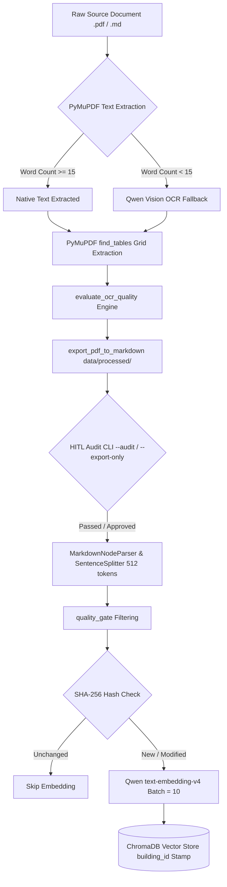

# RAG Data Ingestion Pipeline & HITL Audit Specification

**Status:** Technical Specification Complete  
**Owner:** Data & RAG Engineering Team  
**Implementation Script:** [`../../scripts/ingest_handbook.py`](../../scripts/ingest_handbook.py)  
**Vector Store Target:** ChromaDB (`resident_handbook` collection)  
**Product Authority:** [`../PRD.md`](../PRD.md)

---

## 1. Overview & Architecture

The OnBxrD RAG Data Ingestion Pipeline is responsible for processing resident handbooks, apartment regulations, and complex PDF documents into high-quality vector embeddings stored within ChromaDB. It features a hybrid document loader, automated table structure extraction, optical character recognition (OCR) fallback, quality assessment, a 2-stage Human-in-the-Loop (HITL) audit workflow, multi-tenant isolation, and incremental upserting.



---

## 2. Key Pipeline Features

### 2.1. Hybrid PDF Extraction & OCR Fallback
- **Native Extraction**: Uses PyMuPDF (`fitz`) to rapidly extract native selectable text per page.
- **Vision OCR Fallback**: If a page contains fewer than 15 words (`MIN_PDF_PAGE_WORDS = 15`), the page is rendered as a high-resolution PNG (2.0x scale) and sent to Qwen Vision OCR (`qwen3.6-plus` / `qwen-vl`) to extract Vietnamese text, headers, and structures.

### 2.2. Complex Table Parsing
- **PDF Grid Table Detection**: Invokes PyMuPDF's `find_tables()` API per page.
- **Markdown Grid Conversion**: Converts detected PDF data grids directly into Markdown table blocks (`| Header 1 | Header 2 |`), preserving matrix relationships and preventing digit/price disorientation during RAG retrieval.

### 2.3. 2-Stage HITL Audit Workflow
- **Stage 1 — Automated Quality Engine (`evaluate_ocr_quality()`)**:
  Computes valid word counts and symbol noise ratios. Flags low-quality pages with warning tags (`HIGH_SYMBOL_NOISE`, `LOW_WORD_COUNT`).
  Exports intermediate `.md` files to `data/processed/` annotated with visual HTML comment headers:
  `<!-- Page 4 (Qwen OCR) [AUDIT_REQUIRED: HIGH_SYMBOL_NOISE] -->`
- **Stage 2 — HITL Audit CLI (`--audit` & `--export-only`)**:
  Allows building management (BQL) admins or developers to scan exported markdown files before vector indexing, manually correcting flagged pages in `data/processed/`.

### 2.4. Multi-Tenant Metadata Isolation (`building_id`)
- Every document and chunk node is stamped with a mandatory `building_id` metadata attribute (e.g. `building_id="phu_dong_sky_garden"`).
- Enables zero-leakage pre-filtering during RAG retrieval using LlamaIndex `MetadataFilters` (`ExactMatchFilter`).

### 2.5. Hash-Based Incremental Ingestion
- Computes SHA-256 hashes (`compute_file_hash()`) for every source file.
- Checks vector store metadata before processing: if the document hash matches existing vectors and `--force-rebuild` is not specified, re-embedding is skipped (saving paid API quota).

### 2.6. DashScope Token Bounds & Sub-Chunking
- `MarkdownNodeParser` outputs are sub-chunked using `SentenceSplitter(chunk_size=512, chunk_overlap=64)`.
- Prevents long Markdown section nodes from exceeding DashScope's `text-embedding-v4` token limit per string (resolving API batch overflow errors).

### 2.7. ChromaDB Scalar Metadata Standardization
- ChromaDB enforces strict primitive scalar metadata validation (`str`, `int`, `float`, `bool`, `None`).
- Complex attributes (such as `warning_flags` lists) are converted to comma-separated strings (`"HIGH_SYMBOL_NOISE,LOW_WORD_COUNT"`) prior to storage.

---

## 3. ChromaDB Vector Metadata Schema

Every node indexed into ChromaDB's `resident_handbook` collection contains the following standardized metadata payload:

| Metadata Field | Type | Description | Example |
|---|---|---|---|
| `source_file` | `str` | Name of the original source file | `"so-tay-phu-dong-sky-garden.pdf"` |
| `file_path` | `str` | Absolute path to the source file | `"C:/.../data/raw/handbook.pdf"` |
| `page_number` | `int` | Source PDF page index (1-indexed) | `5` |
| `building_id` | `str` | Tenant building identifier | `"phu_dong_sky_garden"` |
| `is_ocr` | `bool` | Whether page required Qwen Vision OCR | `False` |
| `has_tables` | `bool` | Whether tables were detected on page | `True` |
| `table_count` | `int` | Number of grid tables parsed | `1` |
| `ocr_confidence`| `float` | Quality confidence score (0.0 to 1.0) | `0.95` |
| `warning_flags` | `str` | Comma-separated quality warning flags | `"HIGH_SYMBOL_NOISE"` or `""` |
| `needs_human_audit` | `bool` | Whether page failed quality gate | `False` |
| `version` | `str` | Document schema version | `"1.0"` |
| `document_hash` | `str` | SHA-256 hash of source document | `"98f3908b427288c8..."` |

---

## 4. CLI Reference & Usage

The ingestion script supports a rich set of command-line flags:

```bash
# Basic Ingestion (Default directories: data/raw, data)
python scripts/ingest_handbook.py

# Specify custom building ID for Multi-Tenant isolation
python scripts/ingest_handbook.py --building-id vinhomes_central_park

# Process a specific file or directory
python scripts/ingest_handbook.py --file data/raw/handbook.pdf
python scripts/ingest_handbook.py --dir data/custom_handbooks/

# Stage 1: Export intermediate Markdown files only (HITL Workflow)
python scripts/ingest_handbook.py --export-only

# Stage 2: Scan exported Markdown files for audit warning flags
python scripts/ingest_handbook.py --audit

# Force full index rebuild (ignore SHA-256 cache)
python scripts/ingest_handbook.py --force-rebuild

# Dry-run test (parse, sub-chunk, and validate without calling embedding API or writing ChromaDB)
python scripts/ingest_handbook.py --dry-run
```

---

## 5. Verification & Test Suite

The ingestion pipeline is continuously verified by unit tests in [`tests/test_rag/test_ingestion.py`](../../tests/test_rag/test_ingestion.py):

* `TestComputeFileHash`: Deterministic SHA-256 verification.
* `TestQualityGate`: Validates text filtering rules.
* `TestQwenOCR`: Mocks Qwen Vision API responses and exception handling.
* `TestHybridPDFLoader`: Verifies PyMuPDF text extraction vs. OCR triggers.
* `TestExportPDFToMarkdown`: Validates intermediate markdown formatting and audit tags.
* `TestEvaluateOCRQuality`: Verifies noise ratio and low word count flag generation.
* `TestAuditCLI`: Validates regex scanning over flagged audit headers.
* `TestMultiTenantIngestion`: Verifies `building_id` metadata stamping.
* `TestComplexTableParsing`: Verifies `find_tables()` markdown grid conversion.
