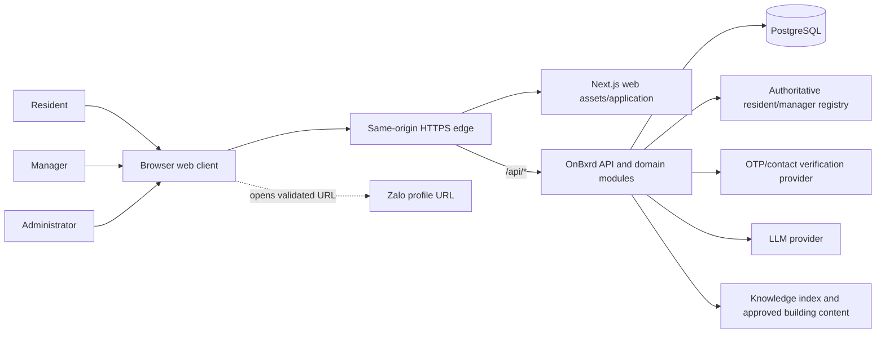

# System Context

## Boundary

OnBxrd is a web application that owns account sessions, resident/manager profile projections, onboarding progress, zero or one persistent resident ticket draft per account, submitted ticket state, in-app notifications, audit events, and rule-based validation of resident-provided Zalo links.

The browser is not trusted. All protected reads and mutations cross the FastAPI authorization boundary. The web client never supplies authoritative role, location, manager scope, or resident snapshot data.

## External Actors

| Actor | Trust level | System interaction |
|---|---|---|
| Resident | Untrusted until authenticated | Registers against resident ID, completes OTP verification, uses onboarding/chat/tickets/profile/notifications |
| Manager | Untrusted until authenticated and scoped | Registers against manager ID, views scoped residents/tickets, changes ticket state, uses `Zalo`, sends `Notify` |
| Administrator | Privileged authenticated operator | Provisioned out of band; creates resident/manager accounts and performs approved lifecycle/correction actions |

## External Systems and Dependencies

| Dependency | Direction | MVP responsibility | Failure posture |
|---|---|---|---|
| Resident/manager registry | Read/version contract | Match IDs and contacts; derive resident location and manager scope | Activation/required scope refresh unavailable; local claim is not committed or stale access fails closed |
| OTP/contact provider | Outbound send, verification callback or polling | Verify a registry-matching phone/email during registration and recovery | Registration remains pending; retry is bounded and idempotent |
| LLM provider | Outbound request | Vietnamese grounded answers and ticket-field patch suggestions | Return unavailable-answer or retry state; never submit a ticket |
| Knowledge index | Read | Retrieve approved building content and source references | Safe unavailable-answer response |
| Zalo | Browser handoff only; no validation API call | Open a locally `ZaloLinkPolicy v1`-validated resident profile URL | Keep `Zalo` action available with safe fallback to `Notify`; no existence or delivery claim |

## Trust Boundaries

1. **Browser to public edge/API:** one origin serves web and proxies `/api/*`; validate every payload and ignore client role, scope, and resident snapshot claims.
2. **API to PostgreSQL:** repositories use parameterized queries and transaction boundaries; database credentials never reach the browser.
3. **API to registry/OTP/LLM:** adapters isolate credentials, timeouts, retries, and provider-specific responses.
4. **API/browser to Zalo:** only rule-validated URLs are emitted; the external site controls the final destination and account context.

## Context Assumptions

- Registry maintenance ownership is intentionally outside MVP architecture; the API consumes the required lookup/version contract and owns the local unique account claim.
- Notification retention and KPI/performance policy are intentionally deferred; schema and operational hooks must not prevent later policy addition.
- No external ticketing system or live Zalo messaging is part of this boundary.
