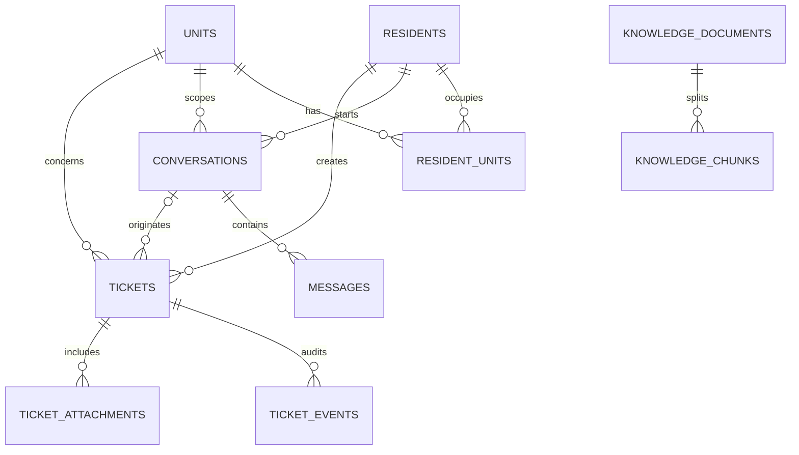
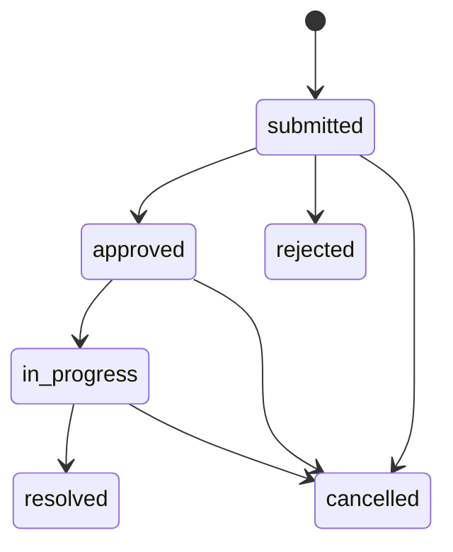

# OnBxrd Backend Database Design

## Pham vi

Co so du lieu phuc vu ba nhom nghiep vu: danh tinh cu dan/can ho, hoi thoai va ticket, va kho tri thuc tu handbook/regulation. Backend la source of truth; agent khong ghi truc tiep vao database.

## Entity relationship



## Bang du lieu

| Bang | Muc dich | Rang buoc quan trong |
|---|---|---|
| `residents` | Ho so cu dan | `resident_code`, email va phone unique |
| `units` | Can ho trong du an/toa nha | Unique theo project + building + unit number |
| `resident_units` | Quan he nhieu-nhieu cu dan/can ho | Backend dung bang nay de kiem tra quyen tao ticket |
| `conversations` | Phien chat, co the anonymous khi chi hoi handbook | Gan resident/unit khi da xac thuc |
| `messages` | Lich su user/assistant, citation va structured action | Khong luu chain-of-thought/internal analysis |
| `tickets` | Yeu cau tu form hoac chatbot | Unique `(resident_id, idempotency_key)` |
| `ticket_events` | Audit log bat bien cua ticket | Luu actor, trang thai cu/moi va comment |
| `ticket_attachments` | Metadata file dinh kem | File duoc luu qua storage adapter |
| `knowledge_documents` | Metadata handbook/regulation | SHA-256 unique, co version va pham vi toa nha |
| `knowledge_chunks` | Doan van ban cho retrieval | Unique `(document_id, chunk_index)`, embedding dung pgvector |

## Ticket state machine



- Ca form va chatbot deu tao ticket o trang thai `submitted` qua cung `TicketService`.
- Quan ly thuc hien `approved`, `rejected`, `in_progress` va `resolved`.
- Cu dan chi co the huy ticket cua chinh minh khi ticket con `submitted`.
- Moi transition tao mot dong `ticket_events`.

## Hai luong tao ticket

```text
Resident form -> POST /api/v1/tickets -> TicketService -> tickets + ticket_events

Resident chat -> POST /api/v1/chat/messages -> Agent structured action
              -> resident confirms -> TicketService -> tickets + ticket_events
```

Agent chi tra `confirm_ticket/create_ticket` voi payload co cau truc. Backend van kiem tra resident-unit, required fields, transition va idempotency truoc khi persist.

## Local runtime

- PostgreSQL 16 + pgvector la database chinh trong `docker-compose.yml`.
- SQLite + JSON vector fallback chi dung cho test nhanh va local fallback.
- `AUTO_CREATE_TABLES=true` ho tro bootstrap local; Alembic la co che migration chinh.
- File handbook duoc luu trong `KNOWLEDGE_STORAGE_DIR`; database chi luu metadata, checksum va chunks.

## Authentication boundary

MVP local dung cac header `X-Actor-Role`, `X-Actor-Id`, `X-Resident-Id`. Day la development adapter de test RBAC va ownership, khong phai authentication production. Khi them JWT/OIDC, chi can thay dependency tao `ActorContext`; service va database rules khong thay doi.

