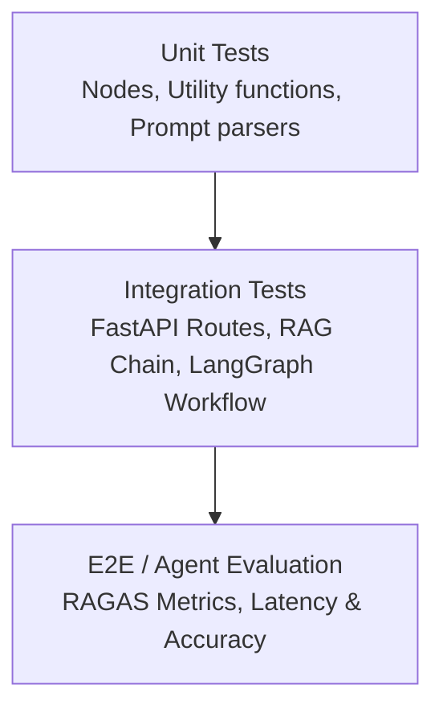

# Kế Hoạch & Báo Cáo Kiểm Thử (Testing Spec & Plan)

> **Dự án:** OnBxrd (BDSO2O-10)
> **Giai đoạn:** Phase 3 (Kiểm thử & QA — Tuần 4)
> **Lệnh chạy test:** `pytest tests/ -v --cov=src`

---

## 1. Chiến Lược Kiểm Thử (Testing Strategy)

### 1.1 Unit Tests (Kiểm thử đơn vị)
- Test các hàm độc lập trong `src/agent/tools.py`, `src/utils/parser.py`.
- Mock toàn bộ các cuộc gọi đến OpenAI API / LLM Provider để tiết kiệm chi phí và chạy nhanh (dùng `unittest.mock.patch`).

### 1.2 Integration Tests (Kiểm thử tích hợp)
- Test kết nối giữa FastAPI backend và LangGraph Agent state.
- Test luồng dữ liệu truyền qua các Node: `Router -> Retriever -> LLM Generator`.

### 1.3 Agent Quality Evaluation (Đánh giá Agent)
- Đánh giá chất lượng RAG bằng khung RAGAS (xem báo cáo tại [eval/results/report.md](file:///d:/P-052/eval/results/report.md)).

---

## 2. Kịch Bản Test Chi Tiết (Test Scenarios)

| Scenario ID | Mô tả test case | Loại Test | Kết quả mong đợi | Trạng thái |
| :--- | :--- | :--- | :--- | :---: |
| `TC-UT-01` | Parse JSON từ LLM output | Unit Test | Trả về dictionary chuẩn, không ném ngoại lệ | 🟢 Pass |
| `TC-UT-02` | Validate định dạng Resident ID | Unit Test | Raise ValidationError nếu id sai format | 🟢 Pass |
| `TC-IT-01` | Gửi câu hỏi qua Endpoint `/chat/completions` | Integration | Trả về stream SSE status 200 | 🟢 Pass |
| `TC-IT-02` | Mock LLM error 429 Rate Limit | Integration | Trả về fallback message thân thiện | 🟢 Pass |
| `TC-E2E-01`| Tra cứu sổ tay cư dân chính xác | Evaluation | Faithfulness Score > 0.85 (RAGAS) | ⏳ In-Progress |

---

## 3. Hướng Dẫn Thêm Test Cases Mới
Tất cả các file test mới phải được đặt trong thư mục `tests/`:
- `tests/test_unit_tools.py`
- `tests/test_api_chat.py`
- `tests/test_agent_workflow.py`
